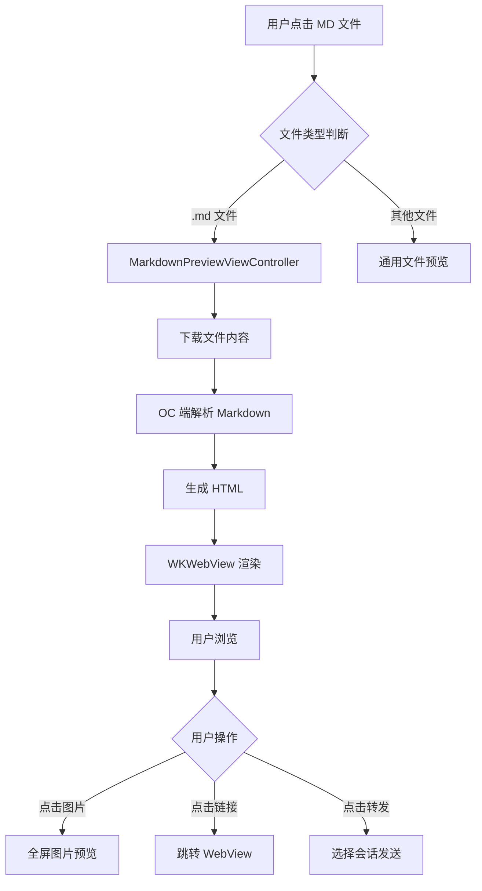

# Markdown 格式全面测试文档

这是一份用于测试 Markdown 预览组件所有支持格式的文档。

## 一、标题层级

# H1 一级标题

## H2 二级标题

### H3 三级标题

#### H4 四级标题

##### H5 五级标题

###### H6 六级标题

---

## 二、文本样式

****粗体文本**** 和 __另一种粗体__

*斜体文本* 和 _另一种斜体_

*****粗斜体文本*****

~~删除线文本~~

==高亮文本== 这段话中 ==重要内容== 被高亮显示

`行内代码` 示例：`NSString *name = @"Demo";`

---

## 三、链接与图片

[示例官网](https://www.example.com)

自动识别裸链接：https://www.apple.com


---

## 四、引用块（支持嵌套）

> 这是第一层引用
>
> 继续第一层内容
>
> 嵌套引用示例：
>
>> 第二层引用内容
>>
>> 继续第二层
>>
>>> 第三层引用，最深层
>>
>> 回到第二层
>
> 回到第一层

---

## 五、无序列表（支持嵌套）

- 水果
  - 苹果
    - 红富士
    - 青苹果
  - 香蕉
  - 橙子
- 蔬菜
  - 番茄
  - 黄瓜
- 饮料
  - 咖啡
  - 茶
    - 绿茶
    - 红茶
    - 乌龙茶

---

## 六、有序列表（支持嵌套）

1. 第一步：需求分析
   1. 收集用户需求
   2. 整理功能列表
   3. 确定优先级
2. 第二步：技术设计
   1. 架构设计
   2. 接口定义
   3. 数据库设计
3. 第三步：开发实现
4. 第四步：测试验证

---

## 七、混合嵌套列表

- 项目计划
  1. 第一阶段
    - 环境搭建
    - 框架选型
  2. 第二阶段
    - 核心功能开发
    - 单元测试
- 注意事项
  - 代码规范
  - 日志规范
    1. Error 级别
    2. Warn 级别
    3. Info 级别

---

## 八、任务列表

- [x] 已完成：嵌套列表支持
- [x] 已完成：脚注功能
- [x] 已完成：嵌套引用
- [x] 已完成：高亮语法
- [x] 已完成：Emoji 短代码
- [ ] 待完成：代码高亮（需引入 highlight.js）
- [ ] 待完成：数学公式（需引入 KaTeX）

---

## 九、表格

| 功能 | 状态 | 优先级 |
|------|------|--------|
| 嵌套列表 | 已完成 | P0 |
| 脚注 | 已完成 | P1 |
| 嵌套引用 | 已完成 | P1 |
| 高亮 | 已完成 | P2 |
| Emoji | 已完成 | P2 |

---

## 十、代码块

```objc
// Objective-C 示例代码
- (void)viewDidLoad {
    [super viewDidLoad];
    NSLogDemoInfo(@"页面加载完成");
    // 初始化 WebView
    [self setupWebView];
}
```

```swift
// Swift 示例
func loadMarkdown(_ content: String) {
    let html = convertToHTML(content)
    webView.loadHTMLString(html, baseURL: nil)
}
```

```json
{
  "name": "MarkdownDemo",
  "version": "3.0.0",
  "features": ["markdown-preview", "nested-list", "footnotes"]
}
```

---

## 十一、Emoji 短代码

表情：:smile: :laughing: :joy: :heart_eyes: :thinking: :sunglasses:

手势：:thumbsup: :clap: :wave: :ok_hand: :pray: :muscle:

符号：:heart: :star: :fire: :100: :sparkles: :zap:

状态：:white_check_mark: :x: :warning: :question: :exclamation:

物品：:rocket: :trophy: :tada: :gift: :computer: :phone:

自然：:sunny: :rainbow: :ocean: :snowflake: :seedling:

动物：:dog: :cat: :monkey: :bug:

食物：:coffee: :pizza: :beer: :cake: :apple:

---

## 十二、脚注

Markdown 预览功能[^1]是示例应用的重要组成部分。该功能使用纯 OC 实现[^2]，不依赖任何外部 Markdown 解析库。

嵌套列表[^nested]和脚注[^footnote]功能是后续迭代中新增的能力。

Mermaid 图表渲染通过 CDN 下载 mermaid.min.js 实现[^mermaid]。

[^1]: MarkdownPreviewViewController 负责 .md 文件的下载和渲染展示

[^2]: 使用 NSRegularExpression 进行正则匹配，逐行解析 Markdown 语法

[^nested]: 嵌套列表通过缩进栈算法实现，支持无限层级

[^footnote]: 脚注定义在文档底部收集，渲染时自动生成锚点链接

[^mermaid]: mermaid.min.js 首次使用从 CDN 下载后本地缓存，后续直接使用缓存

---

## 十三、分割线样式

使用三个短横线：

---

使用三个星号：

***

使用三个下划线：

___

---

## 十四、Mermaid 流程图



---

## 十五、综合测试段落

这是一段包含 ****粗体****、*斜体*、`代码`、==高亮==、~~删除线~~ 和 :rocket: Emoji 的综合段落。同时引用了脚注[^1]，并包含一个[链接](https://example.com)。

> :bulb: ****提示****：以上所有格式都可以在示例 Markdown 预览中正确渲染。
>
>> :star: ==嵌套引用== 中也支持所有行内样式！
